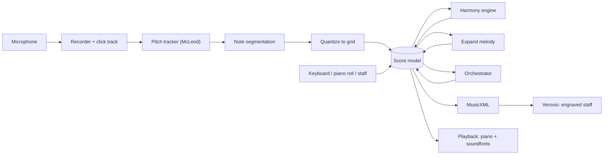

# Composer

**Hum a tune. Get sheet music. Grow it into a full piece.**

Composer is a web app that helps you take a small musical idea, a few notes hummed into your microphone, and develop it into a finished arrangement: from a single melody to piano accompaniment to a full orchestra. It runs in the browser and is designed to work on a phone.

> **Status:** early, working prototype. Everything below runs end to end, but it has had limited testing with real voices and nothing is saved between page refreshes yet. See [Known limitations](#known-limitations).

## What it does

| Step | What you do | What happens |
| --- | --- | --- |
| **Capture** | Pick a tempo and time signature, hum or whistle along to a count-in click | Pitch is tracked live, then turned into notes snapped to a grid. The app suggests a key. You review and preview before anything is added. |
| **Edit** | Tap or drag notes on a **staff** or a **piano roll**, or play notes on the on-screen keyboard | Add, move, resize, transpose, delete. Full undo and redo. Add as many staves as you like. |
| **Harmonize** | Press *Add harmony* | Chords are chosen for your melody and printed above the staff, with an accompaniment staff in one of four styles (block, bass + chord, arpeggio, Alberti). |
| **Expand** | Choose *Continue*, *Vary* or *Develop*, press *Generate* | Three candidate ideas appear as dashed outlines on the piano roll. Preview each, then add the one you like. |
| **Orchestrate** | Pick string quartet, chamber ensemble or full orchestra | A plan decides who plays melody, countermelody, pads, pulse and bass in each section. Edit any cell, then build the score: up to 13 instrument staves, played back with real instrument sounds. |

Everything lands in the same editable score. Nothing is a black box you can't change afterwards.

## Quick start

You need **Node 20+** and **pnpm** (`npm i -g pnpm`).

```bash
git clone https://github.com/germcauley/Capstone_Project.git
cd Capstone_Project
pnpm install
pnpm dev
```

Open <http://localhost:5173> in Chrome or Safari.

`pnpm dev` starts two things: the web app on port 5173 and a small local proxy on port 8787 that powers the *Expand* and *Orchestrate → Ask Claude* features. The rest of the app works without the proxy.

### Trying voice input

1. Click **New** for a blank score.
2. In the capture card set the tempo (start slow, around 70 to 80) and the meter.
3. **Wear headphones** so the click track doesn't leak into the microphone.
4. Press **● Record**, allow microphone access, wait out the count-in bar, then sing or hum one clear note at a time ("la la la" tracks better than a slurred hum).
5. In the review step, try *Preview*, change *Snap to* (1/8 is cleaner than 1/16) and *Octave* (many people hum an octave low), then **Add as new staff**.

Browsers only allow microphone access on `localhost` or HTTPS, so opening the dev server from a phone over your Wi-Fi (`pnpm --filter @composer/web dev:lan`) will load the app but not the microphone. Use an HTTPS tunnel for phone testing.

## How it works



The **score model** is the single source of truth: parts, voices, notes with durations in sixteenths, key, mode, time signature, tempo and chord marks. Capture, editing, harmony, expansion and orchestration all read and write it. It is exported to MusicXML for engraving and flattened to timed notes for playback.

### Pitch to notes

Audio is recorded as raw samples through an `AudioWorklet`. A pitch tracker (McLeod pitch method via [`pitchy`](https://github.com/ianprime0509/pitchy)) turns frames into a pitch contour, which is smoothed and grouped into notes. Notes are then quantized to a grid relative to the count-in, with output latency compensated. Key and mode are estimated with the Krumhansl-Schmuckler algorithm.

### Harmony engine

Deterministic and explainable, not a language model. For each bar (or half bar) it scores candidate chords against the melody, weighting strong beats, and picks the best sequence with the Viterbi algorithm. The vocabulary is diatonic triads plus V7 and a harmonic-minor dominant. Transition scores reward functional movement (such as V to I) and the search is biased toward a tonic start, a half cadence at four-bar phrase ends, and an authentic or half cadence at the finish.

### Expand melody

Three modes, three candidates each:

- **Continue**: write what comes next.
- **Vary**: same shape and harmony, fresh rhythm and notes.
- **Develop**: complete a musical form (AB, ABA, AABA) with a varied repeat, a contrasting B section and a return.

A language model proposes ideas, but its output is never trusted. Each candidate is parsed, snapped to allowed note lengths, folded into a sensible range, trimmed or padded to the exact bar count, and rejected if it is too chromatic, too short or a copy of the original. If nothing survives, the request is retried once.

### Orchestration

Split into **planning** and **writing**, so it works offline and stays editable:

1. **Plan**: a table of *instrument × section* with a role in each cell (melody, doubles, counter, pad, pulse, bass, or silent). Generate it from built-in rules instantly, or ask Claude to plan it (invalid plans are repaired or replaced by the rule-based one). Then edit any cell.
2. **Write**: a deterministic engine realises each role as notes, in concert pitch and inside each instrument's range, using the harmony engine's chords. Pads move by the smallest steps between chords, basses follow chord roots, and counter-lines avoid doubling the melody.

## Generation providers

Generation sits behind a `MelodyGenerator` interface, so the model is swappable. A small local proxy (`apps/proxy`) chooses a provider:

| Provider | When | Notes |
| --- | --- | --- |
| **Claude CLI** | Default | Runs `claude -p` headless on your own Claude plan login. No API key. Hooks, tools and settings are switched off so replies are plain text. **Local use only.** |
| **Anthropic API** | `ANTHROPIC_API_KEY` is set | Messages API, model `claude-sonnet-5-5` (override with `COMPOSER_MODEL`). |

Force one with `COMPOSER_PROVIDER=cli` or `COMPOSER_PROVIDER=api`. The proxy binds to `127.0.0.1` only and rejects non-local origins, because it spends your plan or API credit.

## Project layout

```
packages/core    Pure TypeScript, no UI. Score model, pitch tracking, segmentation, quantize,
                 key detection, edit commands, undo history, MusicXML export, harmony,
                 accompaniment, expand-melody validation, instruments, orchestration.
apps/web         React + Vite app. Verovio engraving, piano roll, capture, panels,
                 playback with smplr (sampled piano + General MIDI soundfonts).
apps/proxy       Local Node server for LLM calls (Claude CLI or Anthropic API).
legacy/          The original Streamlit prototype (see below). Reference only.
```

## Development

```bash
pnpm test        # unit tests for core and proxy (93 tests)
pnpm dev         # web + proxy
pnpm spike       # run the pitch tracker over legacy/sample_audio_files and print notes
```

The musical logic lives in `packages/core` as small pure functions with tests, and the synthetic-audio tests generate sine tones at known pitches and check the whole audio-to-notes pipeline. The UI is verified in the browser.

**Tech:** TypeScript, React, Vite, pnpm workspaces, Vitest, [Verovio](https://www.verovio.org/) (WASM engraving), [smplr](https://github.com/danigb/smplr) (sampled instruments), [pitchy](https://github.com/ianprime0509/pitchy) (pitch detection), Web Audio and AudioWorklet.

## Known limitations

- **Nothing is saved.** Refreshing the page loses your work. Autosave and a project file are next on the list.
- **Voice input is monophonic** and the pitch tracker can make octave errors or miss quiet notes. Fix them in the piano roll.
- **Not yet tested widely with real voices.** Timing is compensated for output latency but not calibrated per device.
- **Staves are single lines**, except accompaniment chords. No tuplets, dynamics, articulations, alto clef or transposing-instrument display yet (orchestral parts are written in concert pitch).
- **Harmony does not auto-update** when you edit the melody. Press *Redo harmony*.
- **Touch dragging** of notes on the piano roll is untested. Tap-select and the nudge buttons work.
- **Generated music is machine-made.** Expect to edit it. Check the licensing rules for any AI-generated material before publishing it.

## Roadmap

- [ ] Save and open projects, export MIDI, MusicXML and PDF
- [ ] Spotify Basic Pitch as an alternative transcriber, then polyphonic input
- [ ] Dynamics, articulations, tuplets, alto clef, transposing instruments
- [ ] Touch-first editing polish and an installable PWA
- [ ] Audio file upload
- [ ] Accounts and cloud save

## Where this came from

This started as a capstone project: a Streamlit app that used [Spotify's Basic Pitch](https://github.com/spotify/basic-pitch) to transcribe an uploaded WAV to MIDI and asked an LLM (Qwen via Hugging Face) to suggest chords. It was inspired by how Irish traditional music is learned by ear, where written versions rarely match a given player.

That version is preserved in [`legacy/`](legacy/) and is still in this repository's git history, with its own [readme](legacy/Readme.md). Composer is a ground-up rewrite that keeps the idea and replaces everything else.
