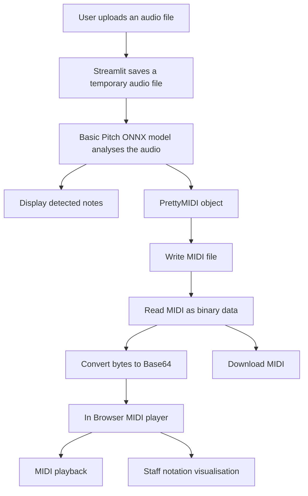

# AI Powered Audio to MIDI Transcription

This capstone project uses Spotify's Basic Pitch model to perform transcription of audio data to MIDI, the common way for musical devices to communicate with each other.
A user can upload a WAV , the application can then analyse the audio and produce a MIDI interpretation of the notes it detects.
The generated MIDI can be played in the browser, viewed as staff notation and downloaded for use in compatible music software.
## Live application link
- [Open the deployed application](https://capstoneproject-audio-to-midi.streamlit.app/)

## Purpose
The purpose of this project is to make it easier to transcribe audio to MIDI and represent it as written notation. It allows the user to listen back to the transcription of an uploaded audio file, inspect a visual representation of it on a musical staff and download the result without installing additional specialist software.


## Main features

- Upload audio in WAV format
- Playback of the original recording
- Transcribe the original audio using the Basic Pitch model
- Display the number of detected notes
- Play transcribed MIDI in the browser
- View MIDI notes displayed on musical staff
- Download of the generated MIDI file for further editing or playback


## How to use the application

1. Open the deployed Streamlit application url
2. Select **Upload** and upload a recording
3. Listen to the uploaded recording using the audio player
4. Select **Convert to MIDI** and wait for the transcription to finish
5. Review the number of notes detected by Basic Pitch
6. Play the generated MIDI 
7. View the detected notes on the musical staff
8. Select **Download MIDI** to save the generated file

## How the application works

1. Streamlit receives the uploaded audio and saves it to a temporary file
2. `audio_to_midi.py` loads the ONNX version of the pretrained Basic Pitch model
3. Basic Pitch analyses the audio and estimates the pitch, timing and velocity of the detected notes
4. The model returns the detected note events and a PrettyMIDI object
5. The PrettyMIDI object is written to a MIDI file
6. The MIDI file is read as binary data and converted to Base64 text so it can be embedded in the player
7. `html-midi-player` using Tone.js and Magenta.js, provides MIDI playback and staff visualisation in the browser
8. The user can save the MIDI data using the download button



## Technologies used

- **Python 3.10:** Main programming language
- **Basic Pitch:** Pretrained neural network for audio transcription
- **ONNX Runtime:** Runs the ONNX version of the Basic Pitch model
- **PrettyMIDI:** Represents and writes the detected notes as MIDI
- **Streamlit:** Framework, provides the web application interface
- **html-MIDI-player:** Provides browser MIDI playback controls
- **Tone.js and Magenta.js:** Synthesize and visualise the MIDI in the browser
- **Git and GitHub:** Version control and source code repo
- **Streamlit Community Cloud:** Deployment platform

## Running the application locally

### Requirements

- Git
- Python 3.10
- An internet connection for the browser-based MIDI player

### Installation

1. Clone the repository:

   ```bash
   git clone https://github.com/germcauley/Capstone_Project.git
   cd Capstone_Project
   ```
2. Create a Python 3.10 virtual environment:

   ```bash
   python3.10 -m venv .venv
   ```

3. Activate the environment:

   ```bash
   source .venv/bin/activate
   ```

4. Install the dependencies from requirements.txt:

   ```bash
   python -m pip install -r requirements.txt
   ```

5. Start the application:

   ```bash
   python -m streamlit run app.py
   ```

6. Open `http://localhost:8501` in a browser

## Deployment

The application is deployed in Streamlit Community CLoud from the `main` branch of the GitHub repository

The deployment is pinned to Python 3.10. Streamlit Community Cloud creates a clean Python environment and installs the packages listed in `requirements.txt`. The application then loads the Basic Pitch ONNX model and performs inference using ONNX Runtime

Using ONNX avoided the need to install TensorFlow or TFLite. This simplified the deployment dependencies.

Updates pushed to the GitHub `main` branch are automatically reflected in the deployed application.

## Evaluation

Four sample audio files were tested against deployed application. Each test covered audio upload, AI transcription, MIDI playback, staff visualisation and file download.

This was a functional evaluation rather than a measurement of transcription accuracy. The listening observations are made against the original audio files and are subjective.

| File | Notes detected | Conversion | MIDI playback | Staff display | Download | Listening observation |
|---|---:|---|---|---|---|---|
| `1.wav` | 45 | Pass | Pass | Pass | Pass | Melody was recognisable |
| `2.wav` | 36 | Pass | Pass | Pass | Pass | Melody was recognisable |
| `3.wav` | 45 | Pass | Pass | Pass | Pass | Melody was recognisable |
| `4.wav` | 104 | Pass | Pass | Pass | Pass| Melody was recognisable |

## Test audio

The four sample recordings were performed and recorded by the project author

## Known limitations

- Basic Pitch works best with audio that contains one clear melody instrument
- The accuracy observations are arrived at subjectively
- The model can sometimes detect slight errors or overtones as additional notes
- Staff notation is generated from the MIDI data and is lacking in the accuracy required to be genuinely useful for musicians right now.Notated rhythms are depicted in extremely complicated forms that a human performer would struggle to read and reproduce. The shortcomings are mainly rhythm based ones. Improving the rhythm and score layout would be the next stage of this project to create something genuinely useful for musicians
- MIDI playback and visualisation depend on an external CDN and therefore require an internet connection
- Simultaneous users could potentially overwrite each other’s generated MIDI file. This has not been tested yet

## Attribution

- [Spotify Basic Pitch](https://github.com/spotify/basic-pitch) provides the pretrained automatic music transcription model
- [html-midi-player](https://github.com/cifkao/html-midi-player) provides the browser MIDI player and visualiser
- Tone.js and Magenta.js provide browser based MIDI synthesis and visualisation capability

## AI assistance
ChatGPT was used for debugging and research. Important areas where it assisted include: selecting and loading the Basic Pitch ONNX model, and resolving Python env issues. The resulting application was written, documented and tested by the project author
