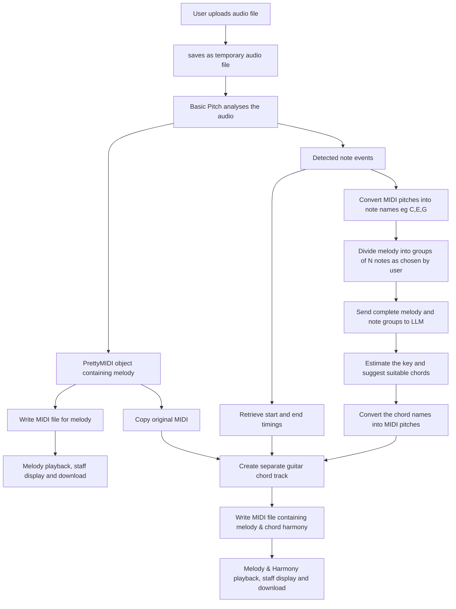

# AI Powered Audio to MIDI Transcription and chord harmonisation

This capstone project uses Spotify's Basic Pitch model to perform transcription of audio data to MIDI. It then uses the Qwen LLM via the Hugging Face Inference API to estimate:
-  the musical key of the melody
-  suggest accompanying chords

Users can upload a WAV , the application can then analyse the audio and produce a MIDI interpretation of the notes along with an interpretation of the melody and suggested chords.
The generated MIDI files can be played in the browser, viewed as staff notation and downloadable for use in compatible music software.
## Live application link
- [Open the deployed application](https://capstoneproject-audio-to-midi.streamlit.app/)

## Purpose
This project was inspired by the way Irish traditional music is often learned aurally rather than via notation. Different musicians may perform unique variations of the same tunes which makes it difficult to find written notation that perfectly matches specific recordings.

The application explores whether artificial intelligence can help turn a recorded melody into a format that is easier to read, replay and share and also whether an LLM can effectively suggest chord arrangements that match the underlying musical key. This is a proof of concept rather than a fully fledged transcription tool.


## Main features

- Upload audio in WAV format
- Playback of the original recording
- Transcribe the original audio using Spotify Basic Pitch 
- Generate a playable and downloaded MIDI transcription of the melody
- View transcribed notes on a musical staff
- select how many notes should be used to recommend chords for the harmony
- Use Qwen LLM to estimate the key and generate major or minor chords
- Add the chords as a separate track and playback or download the result


## How to use the application

1. Open the [Streamlit application url](https://capstoneproject-audio-to-midi.streamlit.app/)
2. Select **Upload** and upload a recording
3. Listen to the uploaded recording using the audio player
4. Select how often the suggested chords should change
5. Select **Transcribe and Harmonise** 
6. Review the musical key suggested by the LLM 
7. Play the MIDI of the original melody and the suggested chord track
8. **Download MIDI** to save the generated files for further playback or editing

## How the application works

1. Streamlit receives the uploaded audio and saves it to a temporary file
2. `audio_to_midi.py` loads the ONNX version of Spotify Basic Pitch model
3. Basic Pitch analyses the audio and estimates the pitch, timing and velocity of the detected notes
4. The model returns the detected note events and a PrettyMIDI object
5. The PrettyMIDI object is written to a MIDI file
6. The MIDI file is read as binary data and converted to Base64 text so it can be embedded in the player
7. `html-midi-player` using Tone.js and Magenta.js, provides MIDI playback and staff visualisation in the browser
8. The user can save the MIDI data using the download button
9. The detected MIDI notes are converted into readable note names
10. The notes are divided into groups of N notes based on the chord frequency selected by the user
11. The complete melody and the note groups are sent to the LLM via the Hugging Face Inference API
12. The LLM returns an estimated key based on the full selection of notes and returns recommended chords for each note group
13. The chord names are converted into MIDI pitches
14. Copy of the original MIDI melody is created, chords are added as a separate MIDI guitar track
15. The original note timings from Basic Pitch transcription are used to determine the start and end points for each chord
16. A MIDI file is written containing the melody and the chord tracks

## Diagram of how it works end to end:


## Technologies used

- **Python 3.10:** Main programming language
- **Basic Pitch:** Pretrained neural network for audio transcription
- **ONNX Runtime:** Runs the ONNX version of the Basic Pitch model
- **PrettyMIDI:** Represents and writes the detected notes as MIDI and creates the chord track
- **Qwen2.5-72B-Instruct:** Large language model used to estimate the key and suggest chords
- **Hugging Face Inference API:** Provides access to this version of Qwen without loading onto the limited Streamlit server
- **Hugging Face Hub:** Python library for interacting with the Hugging Face inference API
- **Streamlit:** Framework, provides the web application interface
- **html-MIDI-player:** Provides browser MIDI playback controls
- **Tone.js and Magenta.js:** Synthesize and visualise the MIDI in the browser
- **Git and GitHub:** Version control and source code repo
- **Streamlit Community Cloud:** Deployment platform

## Running the application locally

### Requirements

- Git
- Python 3.10
- A Hugging Face account and access token
- An internet connection is required for the for MIDI player and for Hugging Face inference to work

### Installation

## Running the application locally

### Requirements

- Git
- Python 3.10
- A Hugging Face account and access token
- An internet connection

### Installation

1. Clone the repository:

   ```bash
   git clone https://github.com/germcauley/Capstone_Project.git
   cd Capstone_Project
   ```

2. Create a Python 3.10 virtual environment:

   ```bash
   python3.10 -m venv .venv
   ```

   This may take a while as it installs a lot of packages.

3. Activate the virtual environment:

   ```bash
   source .venv/bin/activate
   ```

4. Confirm that Python 3.10 is the version being used, if not see the troubleshoting section:

   ```bash
   python --version
   ```

5. Install the project dependencies:

   ```bash
   python -m pip install --upgrade pip
   python -m pip install -r requirements.txt
   ```

6. Create `.streamlit/secrets.toml` using `touch .streamlit/secrets.toml` and add your Hugging Face access token:

   ```toml
   HF_TOKEN = "your_hugging_face_token"
   ```

   This file is excluded from Git by `.gitignore` and must never be committed.

7. Start the application:

   ```bash
   python -m streamlit run app.py
   ```

8. Open `http://localhost:8501` in a browser.

### Troubleshooting

If activating the virtual environment does not select Python 3.10, use the virtual environments executable directly:

```bash
./.venv/bin/python --version
./.venv/bin/python -m pip install -r requirements.txt
./.venv/bin/python -m streamlit run app.py
```

If  `pip` is missing, install it using:

```bash
./.venv/bin/python -m ensurepip --upgrade
```

Basic Pitch may display warnings about TensorFlow, TFLite or scikit.

## Deployment

The application is deployed in Streamlit Community Cloud from the `main` branch of the GitHub repository

The deployment was developed and tested using Python 3.10. Streamlit Community Cloud creates a clean Python environment and installs the packages listed in `requirements.txt`. 

The application then loads the Basic Pitch ONNX model and performs inference using ONNX Runtime

Using ONNX avoided the need to install TensorFlow or TFLite. This simplifies the deployment dependencies.

The Qwen model is not downloaded onto the app server. Instead, we send the detected melody notes to the model via the Hugging Face inference API. This allows the application to use an LLM without overloading the limited memory capacity of the Streamlit server

The Hugging Face access token is stored using Streamlit Community Cloud's secrets management.

Updates pushed to the GitHub `main` branch are automatically reflected in the deployed application.

## Evaluation

Four sample audio files were tested against the deployed app. A chord frequency of one chord for every 3 melody notes was used for each test to make the results easier to compare.

Each test covered upload, transcription to MIDI, melody MIDI playback, key estimation, chord generation, harmonised MIDI playback and file download.

The expected keys for each melody were known in advance. The melody and chords were evaluated by listening and are subjective.

| File | Actual key | AI Estimated key | Melody recognisable after transcription | Chords generated | Chord accompaniment observation | Downloads |
|---|---|---|---|---|---|---|
| `1.wav` | D Maj | D Maj | Yes| Yes | Some variation in chords used. Some clashes. Ends on appropriate chord | Yes |
| `2.wav` | D Maj | F#min | Yes | Yes | Wrong key estimated by AI means it produces chords that are largely clashing with the melody | Yes |
| `3.wav` | G Maj | G Maj | Yes | Yes | Correct key and resolves on the correct chord. Some chords are mismatched with the melody, changing the chord frequency could possibly yield better results. | Yes |
| `4.wav` | G Maj | G Maj | Yes | Yes | Some good variety of chords and mostly complements the melody | Yes |

Basic Pitch produced a recognisable MIDI melody for all four recordings based on the author's subjective listening. Qwen’s estimated key matched the expected key in three of the four tests. Further investigation is required to determine exactly why it chose incorrectly. Chord tracks and downloadable files were successfully generated in every test, but the listening test showed that a correct key estimate does not guarantee every suggested chord will suit the melody.

These results demonstrate that the complete pipeline functions successfully, while also showing that the harmony generation requires some further work before it could be considered genuinely accurate and reliable.
## Test audio

The four sample recordings were performed by a traditional Irish musician and recorded by the author

## Known limitations

- Basic Pitch works best with audio that contains one clear melody instrument
- The accuracy observations are arrived at subjectively
- The model can sometimes detect slight errors or overtones as additional notes
- Staff notation is generated from the MIDI data and is lacking in the accuracy required to be genuinely useful for musicians right now.Notated rhythms are depicted in extremely complicated forms that a human performer would struggle to read and reproduce. The shortcomings are mainly rhythm based ones. Improving the rhythm and score layout would be the next stage of this project to create something genuinely useful for musicians
- MIDI playback and visualisation depend on an external CDN and therefore require an internet connection
- Simultaneous users could potentially overwrite each other’s generated MIDI file. This has not been tested yet
- Qwen is a general purpose LLM , not a model specifically trained on music theory or harmony. Its possible its key and chord suggestions could be wrong
- A correct key does not always guarantee suggested chords will match the melody
- Currently only major and minor triad chords are supported
- Chords are suggested based on a selected number of melody notes. Changing the frequency of chords to notes can produce different results
- An internet connection is required to run the full pipeline successfully

## Attribution

- [Spotify Basic Pitch](https://github.com/spotify/basic-pitch) provides the pretrained automatic music transcription model
- [html-midi-player](https://github.com/cifkao/html-midi-player) provides the browser MIDI player and visualiser
- Tone.js and Magenta.js provide browser based MIDI synthesis and visualisation capability
- [PrettyMIDI](https://github.com/craffel/pretty-midi) used to create and edit the MIDI files
- [Qwen2.5-72B-Instruct](https://huggingface.co/Qwen/Qwen2.5-72B-Instruct) provides us with key and chord estimations
- [Hugging Face Inference API](https://huggingface.co/docs/huggingface_hub/main/guides/inference) provides access to the Qwen model

## AI assistance
ChatGPT was used for guidance, explanation,debugging and research. It assisted with revising the project scope, proposing suitable technologies and reviewing documentation drafts. Important areas where it assisted include:
- A preliminary investigation using the MelodyT5 model that proved to be too complicated for the available development time and streamlit deployment constraints
- selecting and loading the Basic Pitch ONNX model
- resolving Python env issues
- Questions on functions and techniques including: enumerate(), sorted(), lambda functions, comprehensions, deep copying, temporary files and Base64 encoding.
